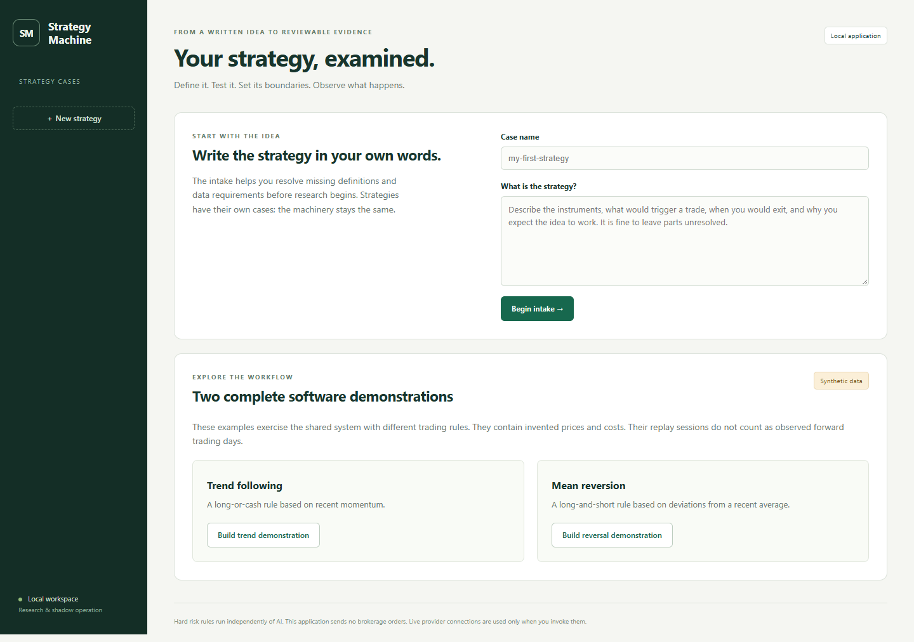

# Strategy Machine

A local application that turns a written trading idea into explicit rules, reproducible research, a risk mandate, controlled shadow operation and a reviewable report. Each strategy has its own case; the machinery stays the same.



## Start here

Install Python 3.12 or later, then download and extract this repository (or clone it). No third-party Python packages, brokerage account or API key are needed for the synthetic demonstrations.

Open a terminal in the project folder and generate the demonstration cases:

```powershell
python -m machine demo --kind momentum --output workspaces/demo-trend
python -m machine demo --kind mean_reversion --output workspaces/demo-reversal
```

On Windows, double-click **Start.cmd** to start the local server and open your browser. It checks for a Codex-bundled Python runtime, then the standard Python launcher or Python on PATH. Keep its terminal open; press Ctrl+C there to stop.

Alternatively, open a terminal in this folder with Python 3.12 or later:

```powershell
python -m machine serve
```

Open `http://127.0.0.1:8877` if the browser does not open. Use `--port 8880` if that port is busy. Cases are stored in this folder's `workspaces` directory. This is a single-user local application, not a public hosting service.

The generated **demo-trend** and **demo-reversal** cases contain complete synthetic demonstrations. Their `report.html` files also open directly without a server. Invented prices, assumed fees and fixture approvals are labelled. They demonstrate software behaviour, not investment performance. Saved workspaces are intentionally excluded from this repository.

## Assignment review

This is an independent educational project prepared for the eToro Active Trading Track; it is not an eToro product. See [the requirements map](docs/REQUIREMENTS.md) for how the assignment informed the implementation, and [validation](VALIDATION.md) for the dated development checks and limitations. Original course PDFs, credentials and private account data are not included.

Reviewers can generate the two demonstrations above, explore the six application stages, run `python -m machine test`, and regenerate the reports using the commands below. Actual execution remains with the human user: the application does not submit brokerage orders. Continuous live account monitoring is not a completed feature; the current eToro integration is a read-only adapter.

## Your first strategy

1. Choose **New strategy** and write the idea in your own words.
2. Work through **Define** with the agent or a coding assistant: hypothesis, signal, entry/exit, sizing, costs, risk, data sources and previous research. Suggestions never become accepted answers automatically.
3. In **Data & setup**, review the executable configuration and policy. Optional AI assistance prepares them from your answers; unresolved numbers remain empty. Accept the translation when it represents your idea. Supply separate chronological training, validation and untouched holdout CSVs. Registration validates and freezes inputs.
4. In **Risk**, commit the dated mandate and run the blocking tests before reviewing the selected trading history. The commitment is timestamped now; it does not claim to predate past trades.
5. In **Research**, run a baseline and justified one-parameter variations. Evaluate the chosen configuration on validation data and chronological folds. Every evaluation attempt is logged, including failures.
6. Review and sign the specification. Signing reruns evidence and an additional-year continuation test, freezes research and unlocks one held-out evaluation. Insufficient Sharpe/DSR evidence blocks signing; figures are not fabricated.
7. In **Operate**, exercise proposals, approvals/rejections, the kill switch, daily reports and independent reconciliation. Historical replay and genuine timestamped forward observation cannot be mixed in one case.
8. In **Report**, regenerate the evidence and tear sheet. Record your keep/adjust/pause/manual decision in **Risk**.

The assessment can be positive, negative or inconclusive. The machine does not promise to find a profitable strategy, guarantee a Sharpe ratio or force a daily trade. Those are strategy-specific objectives to evaluate. `trades_per_session` is an average, not proof of a trade on every session.

## AI assistance

Without a key, the deterministic workflow works. **Export a Codex working packet** creates an intake file and instructions for a coding-assistant conversation. This is a user-mediated workflow, not an automatic connection to an existing chat.

For AI assistance inside the app, set `OPENAI_API_KEY` and `OPENAI_MODEL` in the launch environment. Choose an available model supporting Responses API structured output. Do not put secrets in JSON files or strategy text. Invoked AI actions make paid external calls and send the relevant strategy/evidence to the provider. Keys are not written to case storage. See [integrations](docs/INTEGRATIONS.md).

## Scope

The reference execution model uses synchronized daily bars, next-open targets and one currency. It includes a restricted expression language and a reviewed Python strategy interface. A strategy fitting these contracts reuses the machinery. Intraday trading, options, futures margin, order books, model fitting, multi-currency accounting and broker ticket semantics need appropriate adapters and validation. The intake flags this boundary; it must not silently simplify a strategy.

Operation is **local shadow accounting**. The eToro connector reads portfolio snapshots, rates and recent closed-trade history; it contains no order submission code. Credentials, actual account schemas, a genuine forward feed and five elapsed trading days were unavailable during development. These remain explicit account/operational acceptance activities.

Read the [requirements map](docs/REQUIREMENTS.md), [data contract](docs/DATA.md), [strategy interfaces](docs/STRATEGY_ADAPTERS.md), [operating routine](docs/OPERATIONS.md) and [methods](docs/METHODS.md). **VALIDATION.md** records the checks actually run.

## Reproduce and test

```powershell
python -m machine test
python -m machine reproduce --workspace workspaces/demo-trend
python -m machine reproduce --workspace workspaces/demo-reversal
```

Reproduction recalculates results before writing reports and fails on numerical/source mismatches. It appends replay/audit events; copy a case first if you need an untouched original. Source use needs no third-party Python packages, installation or network for the demonstrations.

```powershell
python -m machine demo --kind momentum --output workspaces/new-trend-demo
python -m machine demo --kind mean_reversion --output workspaces/new-reversal-demo
```

Back up complete case folders, including `ledger.sqlite`, `objects`, `data` and reports. Hash chaining detects partial edits but is not independently notarized or tamper-proof against the machine owner. Never edit stored evidence to repair failed reproduction.
