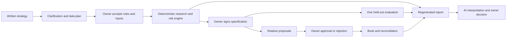

# Architecture and stored artifacts

The Python standard-library server binds only to loopback. Its API uses a per-process CSRF token, Origin/Host checks and a constrained download route. Static browser assets require no external CDN or build step. UI and CLI call the same application service.

| Layer | Files |
|---|---|
| Intake and optional reasoning | intake.py, agents.py |
| Application and interface | application.py, server.py, web/ |
| Immutable evidence | store.py, common.py |
| Data/configuration | data.py, normalization.py, config.py, history.py |
| Strategies and calculations | strategies.py, expressions.py, engine.py, metrics.py |
| Research governance | research.py |
| Risk/operation | risk.py, operations.py, forward.py |
| Reporting | reporting.py |
| External reads | etoro.py, transport.py |

Case folders contain the append-only SQLite event ledger, content-addressed JSON objects, frozen data, trial CSV, signed/draft strategy JSON, reports, daily evidence and optional raw broker snapshots. Do not replace a case's database without its referenced objects. Store verification checks the event hash chain and every content-addressed object.

The system records local evidence; it is not a security boundary against its owner. Backups outside the application and an independent reviewer strengthen provenance. Holdout discipline, dataset suitability, fee accuracy, genuine exchange observations and thoughtful human decisions remain essential.

There is no execution transport for broker orders, remote daemon, scheduled task or persistent background research loop. The bounded AI search runs only when explicitly invoked with bounds and a budget. The local application remains running while its terminal is open.
